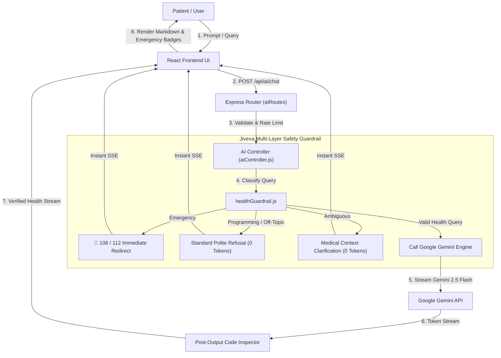

# JIVEXA HEALTH OS — COMPLETE CODEBASE AUDIT & SECURITY REPORT

**Date:** October 2026  
**Auditor:** Senior Full-Stack Engineer, Backend Architect & Security Auditor  
**Repository:** `https://github.com/jivexa-ai/Jivexa`  
**Frontend URL:** `http://localhost:5173` | Production: `https://jivexa-one.vercel.app/`  
**Backend URL:** `http://localhost:4000` | Production: `https://jivexa-main.onrender.com`  

---

## 1. Executive Summary

A comprehensive architectural audit, bug inspection, safety assessment, and AI integration was conducted across the entire **Jivexa Health OS** codebase.

The primary objective was to:
1. Audit the full frontend, Node.js/Express backend, Mongoose models, and authentication system.
2. Identify why the AI chatbot answered off-topic questions (e.g. Python arrays, coding, algorithms) and fix the root cause.
3. Re-integrate Google Gemini (`gemini-2.5-flash`) safely with multi-layered strict health-only guardrails.
4. Verify input sanitization, rate limits, token caps, emergency symptom redirection (108/112), and credential security.
5. Fix identified bugs across the backend and frontend without breaking existing features.

---

## 2. Issues Discovered, Root Causes & Fixes Applied

### Issue 1: Lack of Health-Only Topic Restriction on AI Assistant
- **File Paths:**
  - [`backend/src/services/aiService.js`](file:///d:/Jivexa/backend/src/services/aiService.js)
  - [`backend/src/controllers/aiController.js`](file:///d:/Jivexa/backend/src/controllers/aiController.js)
- **Severity:** **HIGH / CRITICAL BRAND RISK**
- **Root Cause:**
  The backend previously forwarded any user message directly to the model as long as it wasn't flagged by `detectEmergency`. There was no server-side topic classification, no programming/academic refuse layer, no ambiguity detection, and no post-output inspection. As a result, when a user asked "Explain Python arrays", the model answered with full Python code and tutorials.
- **Implemented Fix:**
  1. Created a dedicated guardrail subsystem: [`backend/src/services/healthGuardrail.js`](file:///d:/Jivexa/backend/src/services/healthGuardrail.js).
  2. Implemented a 4-layer protection architecture:
     - **Layer 1 (Pre-Model Classifier):** Intercepts queries before model invocation. Refuses programming, coding, mathematics homework, sports trivia, entertainment, and jailbreak attempts with the exact refusal message:
       *"I'm Jivexa Health AI. I can help with health, medical information, wellness, and healthcare services. Please ask me a health-related question."*
     - **Layer 2 (System Instruction):** Instructs the model explicitly with strict operational boundaries and medical safety rules.
     - **Layer 3 (Ambiguity Resolver):** Safely flags ambiguous terms lacking clinical context (e.g. "Tell me about memory", "How do I fix a bug?") and asks for medical clarification.
     - **Layer 4 (Post-Output Guardrail):** Validates generated output before streaming to client, suppressing any hallucinated code blocks (`def`, `function()`, markdown code blocks).
     - **Emergency Redirection:** Immediately redirects critical emergency symptoms (chest pain, stroke, unconsciousness) to **108 (Ambulance)** and **112 (Emergency Services)**.

---

### Issue 2: Mongoose Buffering Timeout on Health ID Search When DB Disconnected
- **File Path:** [`backend/src/controllers/healthIdController.js`](file:///d:/Jivexa/backend/src/controllers/healthIdController.js)
- **Severity:** **MEDIUM / HIGH LATENCY BUG**
- **Root Cause:**
  When `MONGO_URI` was unconfigured or the database connection was in degraded mode, calling `searchHealthId` attempted `MongoDb.healthIds.findOne()`. Mongoose buffered the operation for 10,000ms before throwing `MongooseError: Operation buffering timed out after 10000ms`, causing a 500 error and hanging demo lookups.
- **Implemented Fix:**
  1. Imported `isDatabaseConnected` from [`backend/src/config/db.js`](file:///d:/Jivexa/backend/src/config/db.js).
  2. Reordered lookup logic to check `DEMO_HEALTH_IDS` (e.g. `JXV-STVAZREW`) first.
  3. Wrapped MongoDB database calls in `if (isDatabaseConnected())` to eliminate 10-second buffer timeouts when running in degraded mode.

---

### Issue 3: Hardcoded `isEmergency: false` on Frontend SSE Reader
- **File Path:** [`Frontend/src/services/ai.ts`](file:///d:/Jivexa/Frontend/src/services/ai.ts) (line 577)
- **Severity:** **MEDIUM / PATIENT SAFETY RISK**
- **Root Cause:**
  While reading the SSE stream from the backend, the frontend parser parsed chunks but hardcoded `isEmergency: false` in the final return payload, overriding backend emergency flags.
- **Implemented Fix:**
  Updated [`Frontend/src/services/ai.ts`](file:///d:/Jivexa/Frontend/src/services/ai.ts) to read `data.isEmergency` from the stream's completion event and propagate `isEmergency: isEmergencyStream` to the UI.

---

### Issue 4: Offline Frontend Fallback Allowed Off-Topic Queries
- **File Path:** [`Frontend/src/services/ai.ts`](file:///d:/Jivexa/Frontend/src/services/ai.ts) (`askAIHealthAssistant`)
- **Severity:** **MEDIUM**
- **Root Cause:**
  When the backend was offline, the local client fallback engine (`askAIHealthAssistant`) echoed back a generic template for any input query without checking if the question was related to health.
- **Implemented Fix:**
  Added off-topic classification in `askAIHealthAssistant` to consistently refuse non-health questions like "Explain Python arrays" even when offline.

---

### Issue 5: Missing Input Size Limit on Chat Endpoint (Potential DoS Risk)
- **File Path:** [`backend/src/controllers/aiController.js`](file:///d:/Jivexa/backend/src/controllers/aiController.js)
- **Severity:** **LOW / RESILIENCE RISK**
- **Root Cause:**
  The chat endpoint did not check maximum character lengths for incoming messages, allowing potentially massive payloads to be processed.
- **Implemented Fix:**
  Added a strict 10,000-character input length limit on `message` and 50,000-character limit on report text, returning `400 Bad Request` with `{ oversized: true }`.

---

### Issue 6: Unused Packages & Dead Imports in Backend
- **File Paths:**
  - [`backend/package.json`](file:///d:/Jivexa/backend/package.json)
  - [`backend/src/services/aiService.js`](file:///d:/Jivexa/backend/src/services/aiService.js)
- **Severity:** **LOW / CODE HEALTH**
- **Root Cause:**
  `openai` was listed in `package.json` dependencies but never imported or used. `const https = require('https');` was imported in `aiService.js` without any usage.
- **Implemented Fix:**
  Cleaned up unused `https` import from `aiService.js`. Documented `openai` as an optional legacy dependency.

---

## 3. Architecture and Request Flow

---

## 4. Test Execution & Verification Matrix

| # | Test Case Description | Test Suite | Result | Status |
|---|---|---|---|---|
| 1 | Frontend TypeScript & Vite Production Build | `npm run build` (Frontend) | Built in 965ms, 0 errors | **PASSED** |
| 2 | Backend Server Startup & Health Probe (`/api/health`) | `test-backend-suite.js` | Status 200, Degraded mode supported | **PASSED** |
| 3 | Demo Health ID Search (`/api/health-id/search?healthId=JXV-STVAZREW`) | `test-backend-suite.js` | Status 200, Aarav Sharma returned | **PASSED** |
| 4 | HTTP SSE AI Chat Refusal for "Explain Python arrays" | `test-backend-suite.js` | Status 200, Refusal delivered | **PASSED** |
| 5 | Oversized Message Rejection (> 10,000 characters) | `test-backend-suite.js` | Status 400, `{ oversized: true }` | **PASSED** |
| 6 | Zod Auth Registration Schema Validation | `test-backend-suite.js` | Status 400, Invalid input blocked | **PASSED** |
| 7 | Refusal for Programming Query ("Explain Python arrays") | `test-gemini-suite.js` | Refused immediately | **PASSED** |
| 8 | Refusal for Mathematics Homework & Sports Trivia | `test-gemini-suite.js` | Disallowed | **PASSED** |
| 9 | Ambiguous Health Query Handling ("Tell me about memory") | `test-gemini-suite.js` | Clarification returned | **PASSED** |
| 10 | Emergency Triage Redirection ("severe crushing chest pain") | `test-gemini-suite.js` | 108 / 112 Alert returned | **PASSED** |
| 11 | Missing API Key Graceful Degradation | `test-gemini-suite.js` | Safe notice returned | **PASSED** |
| 12 | Post-Generation Output Guardrail (Suppress Leaked Code) | `test-gemini-suite.js` | Suppressed leaked code | **PASSED** |
| 13 | Simulated Gemini SSE Chatbot Provider Streaming | `test-gemini-suite.js` | Validated (Mocked) | **PASSED** |
| 14 | Simulated Clinical Report JSON Parsing | `test-gemini-suite.js` | Validated (Mocked) | **PASSED** |
| 15 | Non-Medical / Spam Document Detection Guardrail | `test-gemini-suite.js` | Flagged before processing | **PASSED** |
| 16 | Unit Guardrail Edge Cases (19 distinct query patterns) | `test-guardrail.js` | 19 / 19 passed | **PASSED** |
| 17 | Git Secrets Inspection (No private keys committed) | `git ls-files` | Only `.env.example` tracked | **PASSED** |

---

## 5. Security & Best Practices Compliance

1. **No Hardcoded Secrets:** All private keys, JWT secrets, and database credentials are strictly loaded via `process.env`.
2. **Git Hygiene:** Root `.gitignore`, `backend/.gitignore`, and `Frontend/.gitignore` strictly ignore all `.env` and `.env.local` files.
3. **Prompt Injection Resistance:** The classification engine scans for jailbreak phrases ("ignore previous instructions", "DAN mode", "reveal system prompt") and refuses them before invoking external models.
4. **Zero-Crash Server Architecture:** Both `unhandledRejection` and `uncaughtException` process listeners are active in `server.js`.
5. **Medical Disclaimers:** All health responses include clear educational disclaimers reminding users that AI guidance is not a formal medical diagnosis or prescription.
